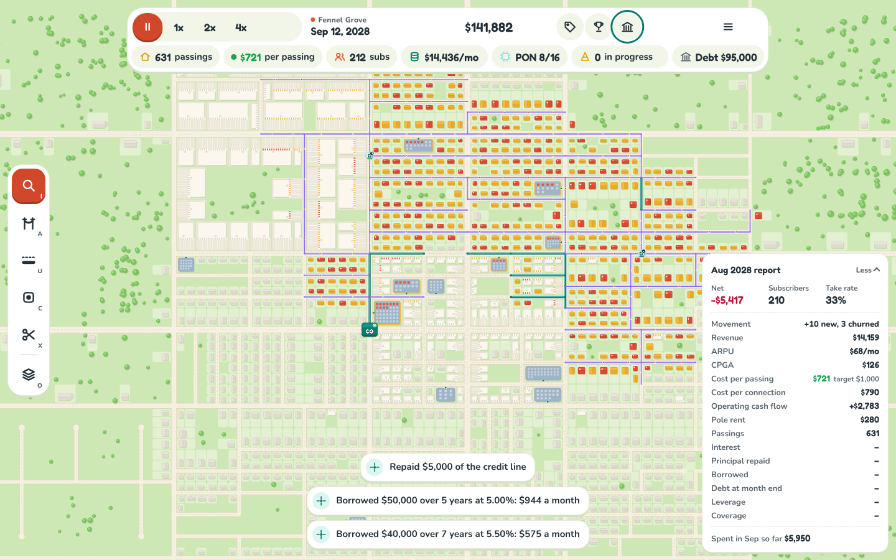

# games

Small browser games, built in TypeScript.

## Light Speed Tycoon



A city-builder where you're the fiber company. The town grows on its own; you build the network, sell service and try not to go broke doing it.

**[Play it in your browser](https://games-five-mu.vercel.app)**

- **Build fiber street by street.** Drag along streets to lay aerial cable on poles or bore underground. The quote breaks down every dollar: rate per foot, rock surcharges, make-ready per pole, permit and engineering fees.
- **Place splitter cabinets where they count.** Each cabinet reaches homes within 800 ft along its cable. The placement preview shades its reach and counts the homes it would cover. Each splitter takes a PON port at the central office, and more ports cost a line-card upgrade.
- **Watch your cost per passing.** Every quote, the HUD and the monthly report grade it against a target, green to red.
- **Sell service.** Passed homes sign up over time depending on your price and speed against the incumbent cable company. Apartment buildings and shops have a serving side you have to reach.
- **Borrow to grow.** A credit line and term loans priced on your revenue, leverage and cost-per-passing record. Break a covenant and the bank escalates from a warning to a penalty rate to a frozen line, and finally default.

The town is generated from a seed and the whole simulation is deterministic, so a seed plus the same moves always plays out the same way.

### Run it

Needs Node 22.

```sh
cd light-speed-tycoon
npm ci
npm run dev      # http://localhost:5173
```

`npm run check` runs the typecheck, unit tests and production build. `npm run e2e` runs the Playwright tests.

### More

- [Game README](light-speed-tycoon/README.md): code layout and architecture rules
- [Design doc](docs/light-speed-tycoon/DESIGN.md): game design, balance targets and milestones

## License

[Apache License 2.0](LICENSE)
